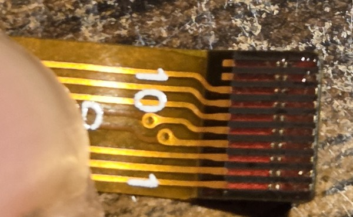
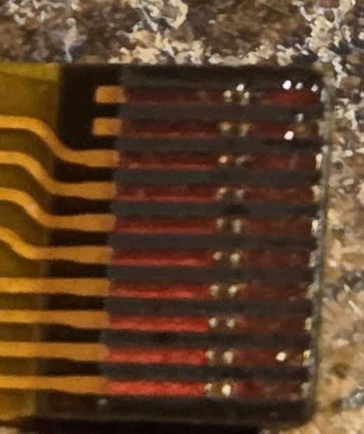
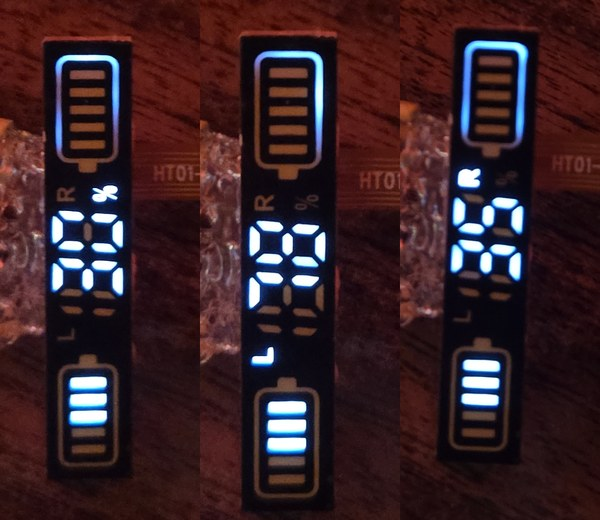

# Earbud-case LED display: pinout and segment map

*Search terms: wireless earbud charging case battery display pinout, TWS earbud case LED display reverse engineering, charlieplexed 10-pin FPC display, HT01-10PIN-FPC-V00, YFTD4108SWAD-8.*

A complete drive map for an unmarked 10-finger FPC LED display salvaged from a wireless earbud charging case: two 5-bar battery gauges, two 7-segment digits plus a "1" stub (0-199), a `%`, `L` and `R` glyphs, and two outline frames. **31 segments, all reachable, charlieplexed over 8 lines.** Includes a ready-to-use ESP32 driver and the probing tools used to find the map, so you can check it against your own copy or repeat the method on a different module.

Markings: the ribbon reads `HT01-10PIN-FPC-V00` (zeros, judged by comparing the glyphs to the "10" on the same ribbon). The side of the panel is printed `YFTD4108SWAD-8 1931`; the `1931` may be a date code (unconfirmed). Which earbud case it came from is unknown, so those two strings are the best handles for finding a match. If yours has the same ribbon and the same face layout, this map should apply, but verify it before trusting it (see "Verifying" below).

## Credits

This map was worked out by **Claude** (Claude Sonnet 5.5, made by [Anthropic](https://www.anthropic.com)), which designed the probing method, wrote the firmware, driver and tooling, and derived the segment map, working with **Michael**, who supplied and soldered the hardware, and acted as the eyes: watching the display and sending photos for each probe step. Neither of us could have done it alone.

## Ribbon pinout

The ribbon has 10 gold fingers, silkscreen-numbered **1 at the right edge to 10 at the left** when the printed labels read upright. **Fingers 9 and 10 are not connected to anything**: a continuity check found no connection to any other finger or wire, and in the photo below their pads have no trace at all. Fingers 1-8 are the 8 charlieplex lines.




Everything in this repo (the segment map, the code) uses **line** numbers 1-8, which are the 8 wires we soldered to the display's pads. Lines 1-7 went to ESP32-C3 GPIO1-7 and line 8 to GPIO10. The ribbon fingers map to lines like this:

| Ribbon finger | 1 | 2 | 3 | 4 | 5 | 6 | 7 | 8 | 9 | 10 |
|---|---|---|---|---|---|---|---|---|---|---|
| Line (code) | 8 | 7 | 6 | 5 | 4 | **2** | **3** | 1 | n/c | n/c |

Note that fingers 6 and 7 are **not** in descending order.

How well each part is established:
- **Segment map by line number:** verified by driving the display. This is the part to trust.
- **Finger-to-line table:** measured with a continuity meter against the wire on each GPIO, fingers 6 and 7 twice each. The pads are tiny, so check it again on your own unit if it matters (for example, if you plan to plug the ribbon into a connector).
- **Fingers 9 and 10:** meter-tested, no continuity to anything.

## How it is driven

Classic charlieplexing. To light one segment: put its **anode** line HIGH, its **cathode** line LOW, and leave every other line as an input (high impedance). Put a **1 kΩ resistor in series with every line**.

- Lines 2-8 act as anodes; **line 1 is never an anode** (seven scan groups).
- A segment's recipe is one anode and one or more cathodes. The "outline" frames light all their LEDs with one anode and all other lines LOW.
- Line 8 (finger 1) is *not* a ground, though it is easy to assume so. It is an anode for the left digit and a cathode for many segments.

### Segment table

Light a segment by driving its **anode line** HIGH and its **cathode line(s)** LOW, with all other lines floating (inputs). The ribbon finger is in parentheses.

**Battery gauge on the `R` glyph side, bars numbered from the terminal nub**

| Segment | Anode: line (finger) | Cathode(s): line (finger) |
|---|---|---|
| `R_bar1` | 3 (f7) | 8 (f1) |
| `R_bar2` | 3 (f7) | 7 (f2) |
| `R_bar3` | 3 (f7) | 6 (f3) |
| `R_bar4` | 3 (f7) | 5 (f4) |
| `R_bar5` | 3 (f7) | 4 (f5) |

**Battery gauge on the `L` glyph side, bars numbered from the terminal nub**

| Segment | Anode: line (finger) | Cathode(s): line (finger) |
|---|---|---|
| `L_bar1` | 6 (f3) | 2 (f6) |
| `L_bar2` | 6 (f3) | 4 (f5) |
| `L_bar3` | 6 (f3) | 5 (f4) |
| `L_bar4` | 6 (f3) | 7 (f2) |
| `L_bar5` | 6 (f3) | 8 (f1) |

**Frames and glyphs**

| Segment | Anode: line (finger) | Cathode(s): line (finger) |
|---|---|---|
| `R_outline` | 2 (f6) | 1 (f8), 3 (f7), 4 (f5), 5 (f4), 6 (f3), 7 (f2), 8 (f1) |
| `L_outline` | 5 (f4) | 1 (f8), 2 (f6), 3 (f7), 4 (f5), 6 (f3), 7 (f2), 8 (f1) |
| `pct` | 4 (f5) | 5 (f4) |
| `letter_R` | 4 (f5) | 6 (f3) |
| `letter_L` | 4 (f5) | 7 (f2) |

**Right-hand digit (nearest `%`), a=top ... g=middle**

| Segment | Anode: line (finger) | Cathode(s): line (finger) |
|---|---|---|
| `ones_a` | 7 (f2) | 8 (f1) |
| `ones_b` | 7 (f2) | 6 (f3) |
| `ones_c` | 7 (f2) | 5 (f4) |
| `ones_d` | 7 (f2) | 4 (f5) |
| `ones_e` | 7 (f2) | 2 (f6) |
| `ones_f` | 7 (f2) | 3 (f7) |
| `ones_g` | 7 (f2) | 1 (f8) |

**Left-hand digit, same lettering**

| Segment | Anode: line (finger) | Cathode(s): line (finger) |
|---|---|---|
| `tens_a` | 8 (f1) | 7 (f2) |
| `tens_b` | 8 (f1) | 6 (f3) |
| `tens_c` | 8 (f1) | 5 (f4) |
| `tens_d` | 8 (f1) | 4 (f5) |
| `tens_e` | 8 (f1) | 2 (f6) |
| `tens_f` | 8 (f1) | 3 (f7) |
| `tens_g` | 8 (f1) | 1 (f8) |

**The "1" stub (hundreds)**

| Segment | Anode: line (finger) | Cathode(s): line (finger) |
|---|---|---|
| `hundreds_1` | 3 (f7) | 1 (f8) |
| `hundreds_2` | 3 (f7) | 2 (f6) |

Notes:
- Digit segment letters: `a` top, `b` upper right, `c` lower right, `d` bottom, `e` lower left, `f` upper left, `g` middle.
- `hundreds_1` / `hundreds_2` are the two segments of the "1" stub; which one is the upper and which the lower was never confirmed.
- Each outline is driven as one whole frame. Several LEDs feed shared light-guide regions, so individual edge pieces were not separated, and one visible region can have more than one valid recipe.

## What it looks like

Left to right: humidity (`%` lit), temperature (`L` lit), pressure (`R` lit), driven by the metrics demo. The top frame glows faintly in all three because this unit lost its one-way mirror film.



## Using the driver

`display_demo/` is an Arduino sketch for an ESP32-C3 (tested on a mini board with a CH340 USB bridge). It has a non-blocking timer-driven scan (about 7 scan groups, 1 ms slot each, roughly 140 Hz per group by calculation, not measured):

```cpp
display::begin();
display::setSegment("tens_a", true);
display::setDigits(42);      // 0-99
display::setBars('L', 3);    // 'L' or 'R', 0-5
```

`segments.json` is the source of truth. Edit it or `gen_segments.py`, then run `python3 gen_segments.py` to regenerate `display_demo/segments_table.h`.

Our wiring (ESP32-C3): lines 1-7 on GPIO1-7, line 8 on GPIO10, a 1 kΩ resistor on each. Avoid GPIO8/9 (strapping), 18/19 (USB) and 20/21 (UART). The driver sets the pin drive strength to the lowest level. **Never connect the display straight to the 3.3 V rail or without series resistors.** The module's LED forward voltage and current limits are unknown.

Brightness is dim at 1 kΩ with 1/7 duty (fine in the dark, hard to see under a lamp). Lower resistors help, but the anode pin of a heavily loaded group carries the whole group's current, so check before going below about 220 Ω. Measured current and exact scan rate are unverified.

## Verifying it on your own unit

`probe/probe.ino` takes serial commands (`H n` one line HIGH, `P a b` a pair, `A n` anode n with all others LOW, `M a mask` anode with a mask of LOW lines, `I` idle) and answers `OK`. The mapping method that worked:

1. For each anode, light it with all other lines LOW and see which regions glow.
2. Number that anode's possible cathodes 1-7. In three photos, pull LOW the cathodes whose number has bit k set; each segment's lit/unlit pattern over the three photos gives its cathode number.

That took about an hour for 31 segments, much less than testing all 56 ordered pairs.

**Ghost glow:** with other lines floating, two LEDs in series can glow dimly through a sneak path, and a phone camera's auto-exposure makes that look lit. A real `a`>`b` segment must also appear in anode `a`'s "all others LOW" sweep. This fooled us several times.

## Known gaps

- Upper vs lower assignment of the two "1" stub segments.
- Outline edges not separated.
- No current or scan-rate measurements.
- The unit we used lost its one-way mirror film when removed from the earbud case, so a faint outline glow is visible on ours that would be hidden on a stock module.

## License

MIT, see `LICENSE`.
